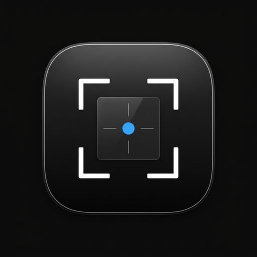
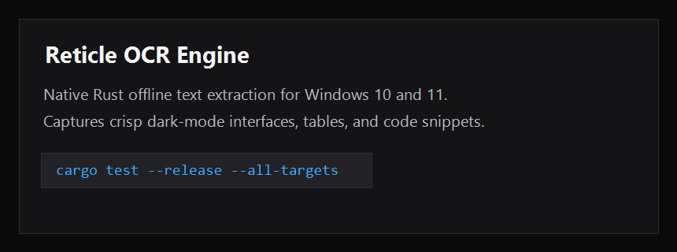
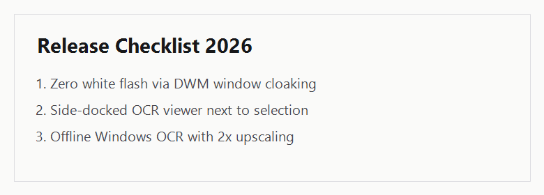
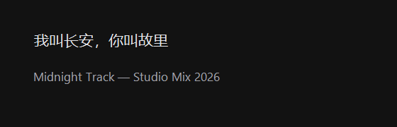

<div align="center">
  
  <h1>Reticle</h1>
  <p><strong>Native Rust snipping, floating pins, annotations, offline OCR, and BYOK AI translation for Windows.</strong></p>

  <p>
    <a href="https://github.com/braces157/reticle/actions/workflows/ci.yml">
      
    </a>
    
    
    <a href="LICENSE">
      
    </a>
  </p>
</div>

---

Reticle is a single-binary, system-tray screenshot and screen-reading utility for Windows written in pure Rust (`eframe` / `egui` + Win32 GDI + DWM + `Windows.Media.Ocr`). Press one global hotkey to freeze your monitors with zero white flash, snip, annotate, pin floating references on top of any app, extract full text offline, or translate and explain code with your own AI API key.

## Highlights

- **Instant Zero-Flash Capture:** Multi-monitor HiDPI Win32 `BitBlt` capture with DWM window cloaking (`DWMWA_CLOAK`) so the overlay reveals only after the first GPU frame is swapped.
- **Full Snip & Annotate Workflow:** Drag, move, resize with 8 precision handles, or nudge by `1px`/`10px`; annotate with Rectangle, Arrow, Pen, Highlighter, irreversible Mosaic pixelation, and inline Text with Undo/Redo.
- **Floating Always-on-Top Pins:** Pin any crop as a borderless floating window (`show_viewport_deferred`) with mouse-wheel zoom, `Shift+Wheel` opacity, hover close, and right-click OCR/Translate/Copy/Save actions.
- **Offline `Windows.Media.Ocr` + Full OCR Viewer:** Direct-RGBA parallel dark-mode passes (`2x–4x` upscaling, zero PNG roundtrip); pre-runs automatically as soon as your selection settles so clicking **OCR** is instant.
- **Speculative Prefetch & Live SSE Streaming:** Pre-warms local OCR, Translate, and Explain Code in the background right after mouse-up (`speculative_prefetch: true`, aborts immediately if you adjust, copy, pin, or cancel). Clicking an action displays instantly from cache or attaches live to the in-flight OpenAI/OpenRouter/Gemini SSE stream, sending compact downscaled JPEGs (`<= 1280px`) instead of raw PNGs.
- **Free Translate & BYOK Vision AI:** Works out of the box with zero API keys (Windows OCR + free translation fallback chain), or configure **Gemini**, **OpenAI**, or any OpenAI-compatible endpoint (such as **OpenRouter**) for layout-aware translation and Markdown **Explain Code**.
- **Precision Obsidian UI:** Quiet dark chrome, inverted-ink capsule CTAs, side-docked popovers (automatically placed right or left of your snip), and native Windows 11 DWM rounded corners.

## Keyboard Shortcuts

| Context | Shortcut | Action |
| :--- | :--- | :--- |
| Global | `Ctrl+Shift+O` (configurable) | Start interactive snip overlay |
| Snip Overlay | `1`–`6` | Toggle Rect, Arrow, Pen, Highlighter, Mosaic, Text |
| Snip Overlay | `Arrow` / `Shift+Arrow` | Nudge selection `1px` / `10px` |
| Snip Overlay | `Enter` / `Ctrl+C` | Copy annotated image to clipboard |
| Snip Overlay | `Ctrl+S` | Save PNG to Screenshots folder |
| Snip Overlay | `P` | Pin floating screenshot on top |
| Snip Overlay | `O` | Offline OCR → copy & open full viewer |
| Snip Overlay | `T` / `E` | Translate / Explain Code (BYOK) |
| Snip Overlay | `Ctrl+Z` / `Ctrl+Y` | Undo / Redo annotation |
| Snip Overlay | `Esc` / Right-click | Exit tool, clear selection, or cancel |
| Pinned Window | `Scroll` / `Shift+Scroll` | Zoom (`25%–400%`) / Opacity (`20%–100%`) |
| Pinned Window | `0` / `Esc` / Double-click | Reset view / Close pin |

## Configuration (`config.json`)

Reticle stores its settings in `%APPDATA%\reticle\config.json` (and automatically reads legacy `%APPDATA%\snip-translate\config.json` if present). Right-click the tray icon → **Open config.json** to customize hotkeys, target language, save directory, or BYOK AI:

```json
{
  "hotkey": "Alt+O",
  "quick_translate_hotkey": null,
  "save_dir": null,
  "target_language": "en",
  "mode": "free",
  "speculative_prefetch": true,
  "ai_provider": {
    "provider": "openai",
    "api_key": "",
    "model": "gpt-4o-mini",
    "base_url": null
  }
}
```

- Set `"mode": "byok"` and provide your own `"api_key"` for `"gemini"` or `"openai"` (set `"base_url": "https://openrouter.ai/api/v1"` for OpenRouter or any OpenAI-compatible provider).
- Set `"speculative_prefetch": false` if you use a paid per-token API key and only want AI requests to fire after you explicitly click **Translate** or **Explain** (offline local pre-OCR and SSE streaming remain active).
- Never commit your personal `config.json` or API keys.

## Real Image Test Suite

Reticle ships with checked-in PNG screenshot fixtures under [`tests/fixtures/`](tests/fixtures/) and runs real end-to-end OCR and annotation compositing tests against them on every `cargo test`:

| Fixture | What It Verifies |
| :--- | :--- |
| [`dark_ui_code_card.png`](tests/fixtures/dark_ui_code_card.png) | Dark-mode `#0A0A0A` interface, prose, and blue-on-dark monospace code pill OCR + annotation/mosaic PNG roundtrip |
| [`light_doc_checklist.png`](tests/fixtures/light_doc_checklist.png) | Light-mode multi-line document OCR completeness |
| [`dark_ui_cjk_card.png`](tests/fixtures/dark_ui_cjk_card.png) | Dark-mode multilingual CJK + Latin media card OCR (validates CJK glyphs when Windows CJK OCR pack is installed) |

<details>
<summary>Preview real PNG test fixtures</summary>

<p>
  
  
</p>
<p>
  
</p>

</details>

## Building & Testing

Requires Rust (stable, 2024 edition) on Windows 10/11:

```powershell
# Run full unit & real PNG image test suite
cargo test

# Lint with strict warnings
cargo clippy --all-targets -- -D warnings

# Build optimized single-binary release executable
cargo build --release
# Output: target\release\reticle.exe
```

To build the marketing/playground website in [`website/`](website/):

```powershell
cd website
npm ci
npm run build
```

## Architecture

- [`src/capture/`](src/capture/) — Multi-monitor Win32 `BitBlt` virtual desktop capture, cropping, PNG export, and downscaled vision JPEG encoding
- [`src/snip/`](src/snip/) — DWM-cloaked full-screen overlay, floating HUD toolbar, annotation model, and CPU rasterizer
- [`src/pin/`](src/pin/) — Deferred-viewport always-on-top pinned screenshot windows
- [`src/ocr.rs`](src/ocr.rs) — Direct-RGBA parallel `Windows.Media.Ocr` pipeline (`2x–4x` upscaling, concurrent dark-mode dual-pass comparison, Otsu fallback)
- [`src/prefetch.rs`](src/prefetch.rs) — Debounced selection-settle speculative prefetcher, live-stream subscriber joining, and instant per-region cache
- [`src/providers/`](src/providers/) — Free translation fallback chain, SSE streaming parser, and BYOK Gemini / OpenAI-compatible vision client
- [`src/ui/`](src/ui/) — Obsidian `egui` popover with live streaming view, side-docked monitor placement, system tray, and global hotkey pump
- [`website/`](website/) — Interactive Vite + TypeScript + Tailwind product site

## License

[MIT](LICENSE)
